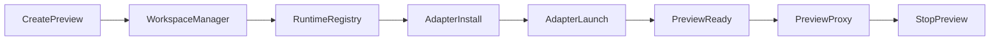

# Preview Sandbox Contract

The preview system is now a host-side, adapter-driven sandbox keyed by opaque `previewId` values.

## Current Endpoints

| Method | Path | Purpose |
|--------|------|--------|
| POST | `/api/previews` | Create a preview from `source: { type, ... }`. Returns `previewId`, `previewUrl`, `status`. |
| GET | `/api/previews/events` | SSE stream of preview lifecycle and log events. Optional `previewId` query narrows the stream. |
| GET | `/api/previews/active` | Return the most recent active preview for the authenticated session. |
| GET | `/api/previews/:previewId` | Return preview session metadata, status, error, and recent logs. |
| POST | `/api/previews/:previewId/stop` | Stop a specific preview by `previewId`. |
| * | `/api/previews/:previewId/*` | Reverse proxy to the preview target after auth and ownership checks. |
| * | `/api/sandpack-proxy` | Proxy to Sandpack CDN for in-browser builder fallback. |

## Source Types

- `builder-files`
  - Ephemeral workspace materialized under `bridge-data/preview`.
  - Used by the project builder and code preview flows.
- `project-path`
  - Uses an existing project directory directly.
  - Used by IDE preview for the active project.

## Runtime Lifecycle

- Each preview is stored by `previewId`, not by session-slot keys.
- The controller owns status transitions: `provisioning`, `materializing`, `installing`, `launching`, `ready`, `stopping`, `failed`, `stopped`.
- The controller stores adapter metadata such as `runtimeId`, `runtimeHandle`, `workspacePath`, and optional workspace cleanup.

## UI Entry Points

- **Builder preview**: `src/dashboard/client/src/components/BuilderCodePreview.tsx`
  - Calls `POST /api/previews` with `source.type = "builder-files"`.
  - Uses the returned `previewUrl` in an iframe.
  - Falls back to Sandpack or `srcDoc` where appropriate.
- **IDE preview**: `src/dashboard/client/src/hooks/usePreview.ts`
  - Calls `POST /api/previews` with `source.type = "project-path"`.
  - Stops via `POST /api/previews/:previewId/stop`.
- **Editor area**: `src/dashboard/client/src/components/EditorArea.tsx`
  - Embeds the `previewUrl` iframe and exposes stop/open controls.

## Runtime Adapters

- **Node**: package-manager install plus host dev server process.
- **Static**: in-process static HTTP server for `dist/`, `build/`, `public/`, or `index.html`.
- **Python**: best-effort host runtime for Streamlit, FastAPI, Flask, Django, or direct script launch.

## Host Runtime Notes

- Host process management lives in `src/dashboard/preview-runner.ts`.
- The old terminal-coupled preview route family is retired.
- On Windows, preview stop uses process-tree termination rather than relying on `shell: true` wrapper processes.
